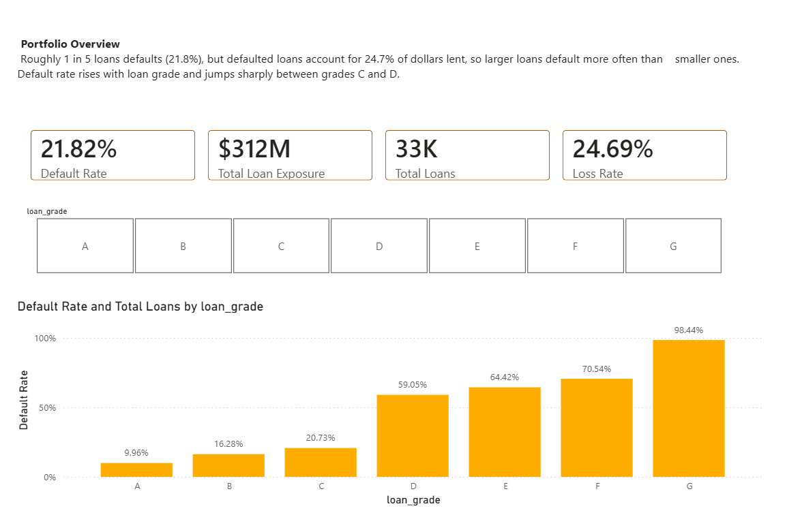
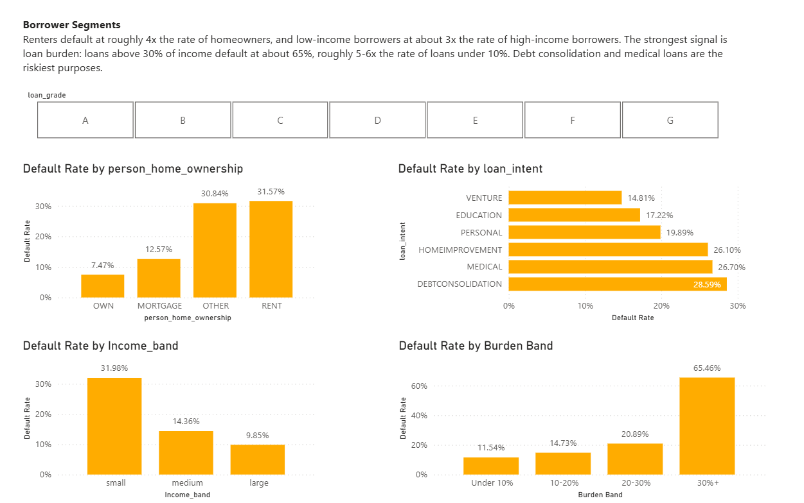
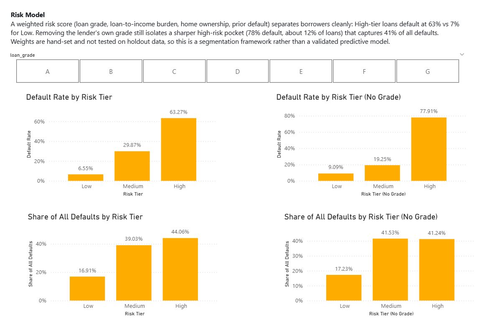

# loan-credit-risk-powerbi-dashboard
Loan default risk analysis in Power BI with a DAX-based risk scoring model

## Overview
An interactive 3-page Power BI dashboard analyzing ~32.6K loans to identify which borrowers 
default and to build a weighted risk-tiering model in DAX.

## Business Question
Which borrower and loan characteristics drive default, and can a simple scoring model 
isolate high-risk loans?

## Key Findings
- **21.8% of loans default**, but defaulted loans account for **24.7% of dollars lent** 
  ($312M total exposure) — larger loans default more often than smaller ones.
- **Default rate climbs with loan grade**, from ~10% (A) to ~98% (G), with a sharp jump 
  between grades C (~21%) and D (~59%).
- **Loan burden is the strongest borrower signal:** loans above 30% of income default at 
  ~65%, roughly 5-6x the rate of loans under 10% of income.
- **Renters default at ~4x the rate of homeowners** (~32% vs ~7%), and low-income 
  borrowers at ~3x the rate of high-income borrowers (~32% vs ~10%).
- **Debt consolidation and medical loans are the riskiest purposes** (~27-29%); venture 
  and education are the safest (~15-17%).

## Risk Tiering Model
Built a weighted risk score in DAX using `VAR`, `SWITCH`, and `IN`, combining loan grade, 
loan-to-income burden, home ownership, and prior default history, then bucketed it into 
Low / Medium / High tiers.

| Model | Low default rate | High default rate | High-tier share of loans | Share of all defaults in High |
|---|---|---|---|---|
| With loan grade | 6.6% | 63.3% | ~15% | 44.1% |
| Without loan grade | 9.1% | 77.9% | ~12% | 41.2% |

Removing the lender's own grade still isolates a sharper high-risk pocket (78% default 
from ~12% of loans). The graded model orders the whole portfolio better, while the 
grade-free model works more as a "flag the worst pocket" tool.

**Limitations:** weights and cutoffs are hand-set from single-factor patterns, and tiers 
are evaluated on the same data they were designed on (no train/test split). This is a 
descriptive segmentation framework, not a validated predictive model.

## Dashboard Pages
1. **Portfolio Overview** — KPI cards (Total Loans, Default Rate, Exposure, Loss Rate), 
   default rate by loan grade, grade slicer
2. **Borrower Segments** — default rate by home ownership, loan purpose, income band, 
   and loan-to-income band
3. **Risk Model** — graded vs. grade-free tiers, default rate and share of all defaults

## Screenshots

## Data Cleaning
- Filled missing employment length with the median
- Left missing interest rates as null to avoid distorting grade-based analysis
- Removed impossible outliers (age and employment length)
- Created helper columns: Income Band, Burden Band

## Tools Used
Power BI Desktop · Power Query · DAX (CALCULATE, SUMX, VAR/RETURN, SWITCH, ALL, IN)

## What I'd Explore Next
Fit a logistic regression on a train/test split to validate the weights, and compare 
its tiers against this hand-built score.

## Dataset
Kaggle: Credit Risk Dataset (add the link to the dataset page you downloaded from)
